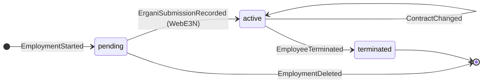
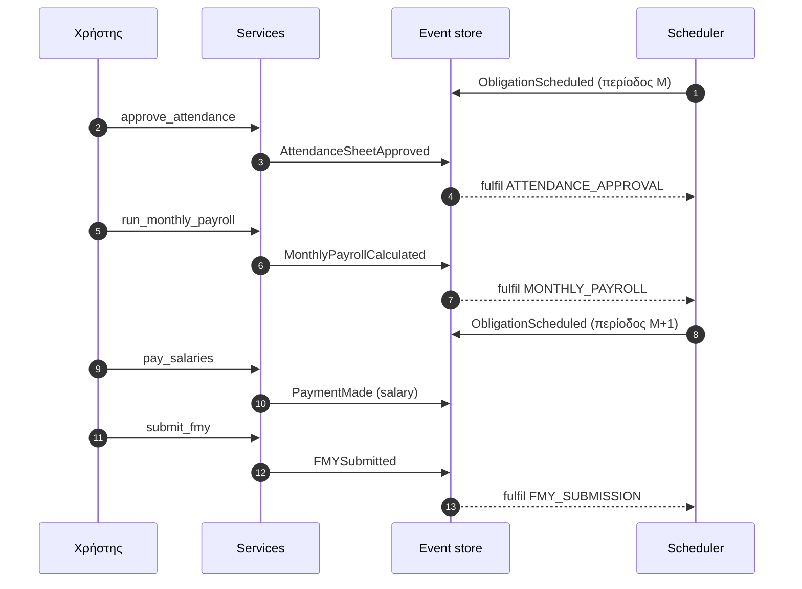
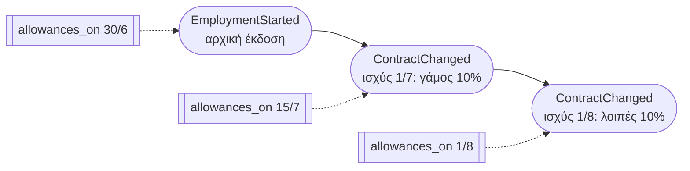
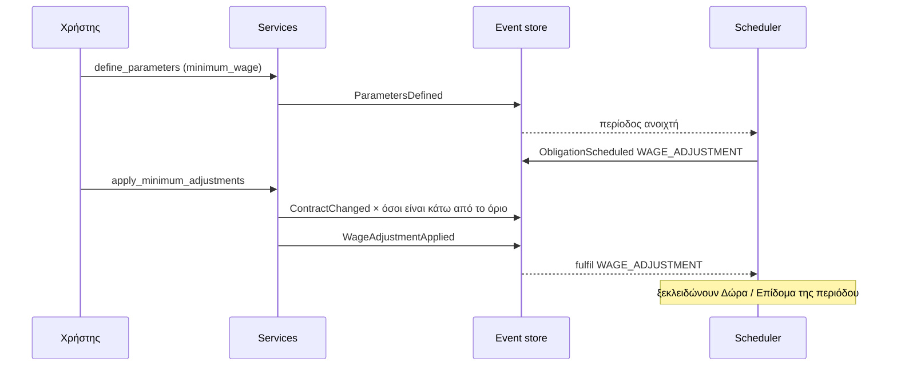
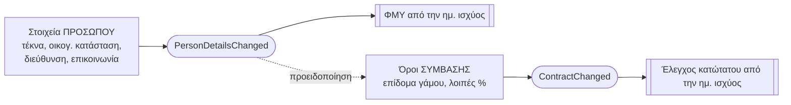
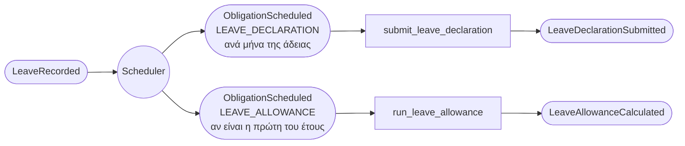
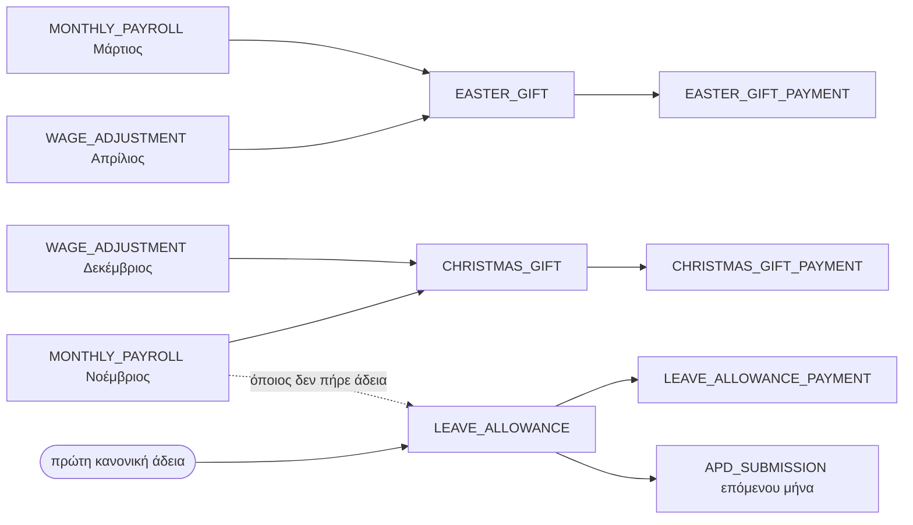
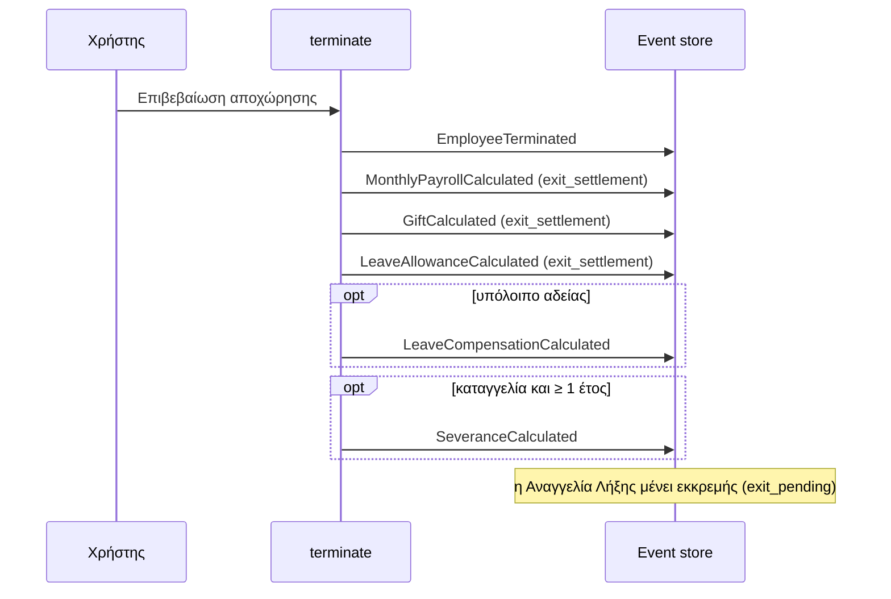

# Event Model του misevent

<!-- ΠΑΡΑΓΕΤΑΙ από docs/event_model/model.json με `uv run python docs/event_model/build.py` — μην το επεξεργάζεσαι εδώ. -->

Η ροή πληροφορίας του συστήματος σε **slices**: ποια οθόνη ξεκινά κάθε βήμα, ποια **εντολή** (μέθοδος service) γράφει ποιο **event**, ποιο **read model** το διαβάζει και ποιος **αυτοματισμός** αντιδρά. Οι νομικοί κανόνες ζουν στο `docs/payroll_rules.md` και στο ARCH_REF §7.

**Οπτικοί πίνακες:** άνοιξε το `docs/event_model/index.html` στον browser.

## Slices

1. [Από την πρόσληψη στη βεβαίωση αποδοχών](#1-hire-to-certificate)
2. [Αλλαγή σύμβασης](#2-contract-change)
3. [Μεταβολή στοιχείων προσώπου](#3-person-change)
4. [Άδειες και ασθένεια](#4-leave-sickness)
5. [Δώρα και Επίδομα Αδείας](#5-gifts-allowance)
6. [Αποχώρηση και εκκαθάριση](#6-exit)

---

## 1. Από την πρόσληψη στη βεβαίωση αποδοχών

Ένας εργαζόμενος από την καταχώρηση ως την ετήσια βεβαίωση αποδοχών. Τα βήματα 4–7 επαναλαμβάνονται κάθε μήνα.

| # | ⬜ Οθόνη | 🟦 Εντολή | 🟧 Events | 🟩 Read model | ⚙️ Αυτοματισμός | 🟪 Εξωτερικό |
|---|---|---|---|---|---|---|
| **1. Πρόσληψη** Εργαζόμενοι → Πρόσληψη | `register_person` `start_employment` | `PersonRegistered` `EmploymentStarted` (draft) `WorkScheduleAssigned` `EmploymentScheduleModeSet` | Καρτέλα απασχόλησης (lifecycle = pending) | — | — |
| **2. Ασφαλιστικά** Καρτέλα → Ασφαλιστικά | `assign_insurance_profile` | `InsuranceProfileAssigned` | — | Υποχρεώσεις ΤΕΚΑ (μόνο αν είναι μέλος) | — |
| **3. Αναγγελία ΕΡΓΑΝΗ** ΕΡΓΑΝΗ → Αναγγελία | `submit_hire_e3` `record_external_hire_submission` | `ErganiSubmissionRecorded` (WebE3N) `ObligationScheduled` (× κάθε περίοδο) | Καρτέλα (lifecycle = active) Χρονολόγιο υποχρεώσεων | `_on_hired` (ανοίγει περιόδους) | ΕΡΓΑΝΗ (WebE3N) |
| **4. Έγκριση παρουσιών** ↻ Παρουσίες μήνα | `approve_attendance` | `AttendanceSheetApproved` `ObligationFulfilled` (ATTENDANCE_APPROVAL) | Συγκεντρωτικό παρουσιών | Εκπλήρωση (ATTENDANCE_APPROVAL) | — |
| **5. Μισθοδοσία** ↻ Μισθοδοσία | `run_monthly_payroll` `reopen_payroll_period` | `MonthlyPayrollCalculated` `ObligationFulfilled` (MONTHLY_PAYROLL) `ObligationScheduled` (μήνας Μ+1) `PayrollPeriodReopened` (μόνο για διόρθωση) | `payroll_ledger` Δεδουλευμένα (accruals) | Εκπλήρωση + άνοιγμα Μ+1 (Νοέμβριος: Επίδομα Αδείας) | — |
| **6. Πληρωμή μισθών** ↻ Χρονολόγιο (ή αυτόματα) | `pay_salaries` | `PaymentMade` (salary) `ObligationFulfilled` (SALARY_PAYMENT) | — | Εκπλήρωση (SALARY_PAYMENT) | — |
| **7. Δήλωση ΦΜΥ** ↻ Αρχεία ΦΜΥ | `generate_fmy_file` `submit_fmy` `pay_fmy` | `FMYFileGenerated` `FMYSubmitted` `ObligationFulfilled` (FMY_SUBMISSION) | — | Εκπλήρωση (FMY_SUBMISSION) | ΑΑΔΕ (myAADE) |
| **8. Βεβαίωση αποδοχών** Πρόσωπο → Βεβαιώσεις | — | — | `tax_certificate` `year_pending` (οριστική ή ΠΡΟΣΩΡΙΝΗ) | — | — |

### Κανόνες

- **1. Πρόσληψη**
  - Έλεγχος κατώτατου με τριετίες, γάμο και λοιπές προσαυξήσεις ήδη στην πρόσληψη.
  - Το πρόγραμμα εργασίας ισχύει από την ανάληψη (σε μεταφορά όχι αναδρομικά).
  - Ξεκινούν τα ιστορικά σύμβασης και προσαυξήσεων (`contract_history`, `allowance_history`).
- **2. Ασφαλιστικά**
  - Ο ΚΠΚ και οι καλύψεις ορίζουν τις εισφορές της μισθοδοσίας.
  - Μέλος ΤΕΚΑ με αναγγελμένη πρόσληψη γεννά ΑΠΔ και καταβολή ΤΕΚΑ ανά περίοδο.
- **3. Αναγγελία ΕΡΓΑΝΗ**
  - Χωρίς αναγγελία ο εργαζόμενος δεν μπαίνει σε μισθοδοσία (`hire_submitted`).
  - Σε μεταφορά από άλλο πρόγραμμα: `record_external_hire_submission`, χωρίς κλήση στο ΕΡΓΑΝΗ.
  - Ο scheduler ανοίγει για κάθε περίοδο: παρουσίες, μισθοδοσία, πληρωμή, ΑΠΔ, ΦΜΥ, Δώρα.
- **4. Έγκριση παρουσιών**
  - Οι ημέρες της μισθοδοσίας βγαίνουν από το εγκεκριμένο συγκεντρωτικό, όχι απευθείας από τις παρουσίες.
  - Χειροκίνητες διορθώσεις γίνονται πριν την έγκριση.
- **5. Μισθοδοσία**
  - Η περίοδος πρέπει να είναι ανοιχτή και οι προηγούμενοι μήνες υπολογισμένοι.
  - Απαιτεί εγκεκριμένο συγκεντρωτικό παρουσιών.
  - Καμία παράβαση κατώτατου, με τις προσαυξήσεις που ίσχυαν στην περίοδο (`allowances_on`).
  - Ήδη υπολογισμένη περίοδος: πρώτα `reopen_payroll_period`.
- **6. Πληρωμή μισθών**
  - Με τη ρύθμιση `auto_payments` η πληρωμή γίνεται μόλις ξεκλειδώσει και δεν εμφανίζεται στο χρονολόγιο.
- **7. Δήλωση ΦΜΥ**
  - Το αρχείο JL10 δεν γράφεται στον δίσκο· παράγεται από τα events όποτε ζητηθεί.
  - Περιλαμβάνει τακτικές αποδοχές και τα Δώρα/Επίδομα του μήνα.
- **8. Βεβαίωση αποδοχών**
  - Μόνο ανάγνωση: καμία εντολή, κανένα event.
  - Αθροίζει όλες τις απασχολήσεις του προσώπου στο έτος.
  - Αν το `year_pending` βρει εκκρεμότητες, το PDF γράφει «ΠΡΟΣΩΡΙΝΗ» και τις απαριθμεί: μήνας χωρίς μισθοδοσία, Δώρο/Επίδομα που δεν υπολογίστηκε, απλήρωτο ποσό, ΦΜΥ που δεν δηλώθηκε.

### Κύκλος ζωής απασχόλησης

### Ο μηνιαίος κύκλος υποχρεώσεων

---

## 2. Αλλαγή σύμβασης

Αλλαγή αποδοχών, ωραρίου ή προσαυξήσεων με ημερομηνία ισχύος, η Δήλωση Μεταβολής στο ΕΡΓΑΝΗ, και η αυτόματη προσαρμογή όταν αλλάζει ο κατώτατος μισθός.

| # | ⬜ Οθόνη | 🟦 Εντολή | 🟧 Events | 🟩 Read model | ⚙️ Αυτοματισμός | 🟪 Εξωτερικό |
|---|---|---|---|---|---|---|
| **1. Αλλαγή σύμβασης** Καρτέλα → Αλλαγή σύμβασης | `change_contract` | `ContractChanged` (με ημ. ισχύος) | `contract_on` `allowances_on` Ιστορικό συμβάσεων (_contract_history) | — | — |
| **2. Δήλωση Μεταβολής** ΕΡΓΑΝΗ → Μεταβολές | `submit_metavoli` | `ErganiSubmissionRecorded` (E4_METAVOLI) | `pending_metavoli` | — | ΕΡΓΑΝΗ (Δήλωση Μεταβολής) |
| **3. Νέα ΓΣΣΕ** Σύστημα → Παράμετροι | `define_parameters` | `ParametersDefined` (minimum_wage) `ObligationScheduled` (WAGE_ADJUSTMENT) | — | `_ensure_wage_adjustment` (αν η περίοδος έχει ανοίξει) | — |
| **4. Προσαρμογή στον κατώτατο** Χρονολόγιο → Προσαρμογή | `apply_minimum_adjustments` | `ContractChanged` (αιτία: ΓΣΣΕ) `WageAdjustmentApplied` `ObligationFulfilled` (WAGE_ADJUSTMENT) | — | Εκπλήρωση (WAGE_ADJUSTMENT) | — |
| **5. Διόρθωση πρόσληψης** Καρτέλα → Διόρθωση πρόσληψης | `correct_hire_details` | `EmploymentHireDetailsCorrected` | `contract_history` (αρχική έκδοση) | — | — |

### Κανόνες

- **1. Αλλαγή σύμβασης**
  - Έλεγχος κατώτατου στην ημερομηνία ισχύος: τριετίες ως τότε, γάμος και λοιπές προσαυξήσεις όπως θα ισχύουν τότε.
  - Στο event, `None` σημαίνει «αμετάβλητο» (σύστημα εργασίας, επίδομα γάμου, λοιπές %).
  - Οι προσαυξήσεις ισχύουν από την ημερομηνία της μεταβολής (`allowance_history`).
  - Κάθε μεταβολή αφήνει μία εκκρεμή Δήλωση Μεταβολής.
- **2. Δήλωση Μεταβολής**
  - Μία δήλωση ανά μεταβολή, με τους δικούς της όρους (subject `E4:n`).
  - Μεταβολές πριν την αναγγελία πρόσληψης τις καλύπτει το ίδιο το WebE3N.
- **3. Νέα ΓΣΣΕ**
  - Νέος κατώτατος με ημερομηνία ισχύος· αν η περίοδος είναι ήδη ανοιχτή, η υποχρέωση προσαρμογής γεννιέται αμέσως.
  - Οι αρχικές τιμές έρχονται από το `data/init_parameters.json`.
- **4. Προσαρμογή στον κατώτατο**
  - Όποιος αμείβεται κάτω από το προσωπικό του όριο ανεβαίνει σε αυτό, με κανονική μεταβολή σύμβασης και Δήλωση Μεταβολής.
  - Με «διατήρηση διαφοράς» περνά η αύξηση του ορίου σε όλους.
  - Τα Δώρα και το Επίδομα Αδείας της ίδιας περιόδου περιμένουν την προσαρμογή.
- **5. Διόρθωση πρόσληψης**
  - Διορθώνει λάθος της φόρμας πρόσληψης· αντικαθιστά μόνο την αρχική έκδοση της σύμβασης.
  - Οι μεταγενέστερες μεταβολές μένουν όπως είναι.

### Εκδόσεις σύμβασης στον χρόνο

### Αλυσίδα νέας ΓΣΣΕ

---

## 3. Μεταβολή στοιχείων προσώπου

Οικογενειακή κατάσταση, τέκνα, διεύθυνση και επικοινωνία αλλάζουν στο πρόσωπο με ημερομηνία ισχύος· γέννηση τέκνου και μειωμένο ωράριο αφορούν την απασχόληση.

| # | ⬜ Οθόνη | 🟦 Εντολή | 🟧 Events | 🟩 Read model | ⚙️ Αυτοματισμός | 🟪 Εξωτερικό |
|---|---|---|---|---|---|---|
| **1. Μεταβολή** Εργαζόμενοι → 🔄 Μεταβολή | `change_person_details` | `PersonDetailsChanged` (με ημ. ισχύος) | `children_on` Καρτέλα προσώπου | — | — |
| **2. Διόρθωση** Εργαζόμενοι → ✏️ Διόρθωση | `correct_person` | `PersonDetailsCorrected` | Καρτέλα προσώπου | — | — |
| **3. Γέννηση τέκνου** Καρτέλα απασχόλησης | `record_child_birth` | `ChildBirthRecorded` | `mother_subsidy_on` | — | — |
| **4. Μειωμένο ωράριο τέκνου** Καρτέλα → Φροντίδα τέκνου | `set_childcare_reduction` | `ChildcareReductionSet` | `childcare_reduction` | — | ΕΡΓΑΝΗ (νέο πρόγραμμα) |

### Κανόνες

- **1. Μεταβολή**
  - Τα τέκνα επηρεάζουν τον ΦΜΥ μόνο από την ημερομηνία ισχύος (`children_on`).
  - Αλλαγή τέκνων απαιτεί ανοιχτή μισθολογική περίοδο.
  - Η αλλαγή οικογενειακής κατάστασης δεν αλλάζει το επίδομα γάμου· αυτό γίνεται με «Αλλαγή σύμβασης» (slice 2).
- **2. Διόρθωση**
  - Για λάθη καταχώρησης· ισχύει από πάντα, όχι από ημερομηνία.
- **3. Γέννηση τέκνου**
  - Ενεργοποιεί την επιδότηση εισφορών μητέρας (ΑΠΔ 103) για το διάστημα που ορίζει ο νόμος.
- **4. Μειωμένο ωράριο τέκνου**
  - Η σύμβαση δεν αλλάζει· επιτρέπεται απλώς μικρότερο πρόγραμμα, που δηλώνεται στο ΕΡΓΑΝΗ όπως κάθε αλλαγή προγράμματος.
  - Νέα δήλωση αντικαθιστά την προηγούμενη· κενή επιλογή την καταργεί.

### Δύο διαδρομές αλλαγής μετά την πρόσληψη

---

## 4. Άδειες και ασθένεια

Καταχώρηση, μετάθεση και ακύρωση αδειών, η μηνιαία δήλωση αδειών στο ΕΡΓΑΝΗ, και πώς η ασθένεια περνά στη μισθοδοσία.

| # | ⬜ Οθόνη | 🟦 Εντολή | 🟧 Events | 🟩 Read model | ⚙️ Αυτοματισμός | 🟪 Εξωτερικό |
|---|---|---|---|---|---|---|
| **1. Καταχώρηση άδειας** Άδειες MCP (record_leave) | `record_leave` `plan_annual_leave` | `LeaveRecorded` `ObligationScheduled` (LEAVE_DECLARATION) `ObligationScheduled` (LEAVE_ALLOWANCE) | `annual_leave_entitlement` `annual_leave_accrued` `annual_leave_taken` | `_sync_allowances` (πρώτη κανονική άδεια) Δήλωση αδειών (για κάθε μήνα) | — |
| **2. Μετάθεση ή ακύρωση** Άδειες → Μετάθεση / Ακύρωση | `reschedule_leave` `cancel_leave` | `LeaveRescheduled` `LeaveCancelled` | `leave_declared_to_ergani` | `_sync_allowances` (μετακινεί το Επίδομα) | — |
| **3. Δήλωση αδειών ΕΡΓΑΝΗ** ΕΡΓΑΝΗ → Δήλωση αδειών | `submit_leave_declaration` | `LeaveDeclarationSubmitted` `ErganiSubmissionRecorded` (WTOLeave) `ObligationFulfilled` (LEAVE_DECLARATION) | `leave_declaration_proposal` | Εκπλήρωση (LEAVE_DECLARATION) | ΕΡΓΑΝΗ (WTOLeave) |
| **4. Ασθένεια στο συγκεντρωτικό** ↻ Παρουσίες μήνα | `approve_attendance` | `AttendanceSheetApproved` (sick_half / sick_full) | `sick_balance` (χρήση / όριο / από) `sick_deduction` | — | — |
| **5. Επίδομα ασθενείας ΕΦΚΑ** Καρτέλα → Άδειες ασθενείας | `record_sickness_benefit` | `SicknessBenefitRecorded` | `sick_deduction` | — | e-ΕΦΚΑ (έγκριση επιδόματος) |

### Κανόνες

- **1. Καταχώρηση άδειας**
  - Η άδεια πρέπει να είναι σε ανοιχτή περίοδο, μέσα στην απασχόληση, χωρίς επικάλυψη.
  - Οι ημέρες μετρούν σε εργάσιμες Δευτέρα–Παρασκευή, και για εξαήμερο.
  - Η πρώτη κανονική άδεια του έτους γεννά το Επίδομα Αδείας στον μήνα της (slice 5).
- **2. Μετάθεση ή ακύρωση**
  - Άδεια που έχει δηλωθεί στο ΕΡΓΑΝΗ κλειδώνει.
  - Αν μετακινηθεί η πρώτη άδεια, η ανοιχτή υποχρέωση Επιδόματος που μένει χωρίς δικαιούχο κλείνει.
- **3. Δήλωση αδειών ΕΡΓΑΝΗ**
  - Απολογιστική: μετά την έγκριση παρουσιών του μήνα, έως το τέλος του επόμενου μήνα.
  - Χωρίς αδήλωτες άδειες απλώς κλείνει την υποχρέωση.
- **4. Ασθένεια στο συγκεντρωτικό**
  - Οι ημέρες ασθένειας μετρούν σε κυλιόμενο παράθυρο 365 ημερών.
  - Το συγκεντρωτικό χωρίζει τις ημέρες σε μισές (τριήμερο) και πλήρεις· στις πλήρεις αφαιρείται το επίδομα ΕΦΚΑ.
- **5. Επίδομα ασθενείας ΕΦΚΑ**
  - Το ποσό γίνεται γνωστό εκ των υστέρων, γι' αυτό καταχωρείται χειροκίνητα.
  - Αφαιρείται από όσα οφείλει ο εργοδότης για τις ημέρες που πληρώνονται κανονικά, όχι από το τριήμερο.

### Τι γεννά μία κανονική άδεια

---

## 5. Δώρα και Επίδομα Αδείας

Δώρο Πάσχα, Δώρο Χριστουγέννων και Επίδομα Αδείας: πότε γεννιούνται, τι περιμένουν για να ξεκλειδώσουν, και πώς πληρώνονται.

| # | ⬜ Οθόνη | 🟦 Εντολή | 🟧 Events | 🟩 Read model | ⚙️ Αυτοματισμός | 🟪 Εξωτερικό |
|---|---|---|---|---|---|---|
| **1. Προγραμματισμός Δώρων** Χρονολόγιο | — | `ObligationScheduled` (EASTER_GIFT / CHRISTMAS_GIFT) | — | `_ensure_gifts` (με το άνοιγμα κάθε έτους) | — |
| **2. Δώρο Πάσχα** Χρονολόγιο → Δώρο Πάσχα | `run_easter_gifts` | `GiftCalculated` `ObligationFulfilled` (EASTER_GIFT) `ObligationScheduled` (EASTER_GIFT_PAYMENT) | — | `_ensure_payouts` (γεννά την καταβολή) | — |
| **3. Δώρο Χριστουγέννων** Χρονολόγιο → Δώρο Χριστουγέννων | `run_christmas_gifts` | `GiftCalculated` `ObligationFulfilled` (CHRISTMAS_GIFT) `ObligationScheduled` (CHRISTMAS_GIFT_PAYMENT) | — | `_ensure_payouts` (γεννά την καταβολή) | — |
| **4. Επίδομα Αδείας** Χρονολόγιο → Επίδομα Αδείας | `run_leave_allowance` | `LeaveAllowanceCalculated` `ObligationFulfilled` (LEAVE_ALLOWANCE) `ObligationScheduled` (LEAVE_ALLOWANCE_PAYMENT) | `allowance_beneficiaries` | Γέννηση (πρώτη άδεια ή Δεκέμβριος) | — |
| **5. Καταβολή** Χρονολόγιο (ή αυτόματα) | `pay_gifts` `pay_leave_allowance` | `PaymentMade` (gift / allowance) `ObligationFulfilled` (…_PAYMENT) | `year_pending` | Εκπλήρωση (…_PAYMENT) | — |

### Κανόνες

- **1. Προγραμματισμός Δώρων**
  - Δεν προγραμματίζονται αν η προθεσμία τους είναι πριν την πρώτη πρόσληψη.
  - Προθεσμία Πάσχα: Μεγάλη Τετάρτη. Χριστουγέννων: 21/12.
- **2. Δώρο Πάσχα**
  - Ξεκλειδώνει με τη μισθοδοσία Μαρτίου και την προσαρμογή κατώτατου του Απριλίου.
  - Υπολογίζεται στον μισθό που ίσχυε 15 ημέρες πριν την καταβολή (`contract_on`).
- **3. Δώρο Χριστουγέννων**
  - Ξεκλειδώνει με τη μισθοδοσία Νοεμβρίου και την προσαρμογή κατώτατου του Δεκεμβρίου.
- **4. Επίδομα Αδείας**
  - Δύο ημερομίσθια ανά μήνα απασχόλησης, με ανώτατο μισό μισθό.
  - Γεννιέται στον μήνα της πρώτης κανονικής άδειας· όποιος δεν πήρε άδεια το έχει υποχρεωτικά τον Δεκέμβριο, μόλις κλείσει ο Νοέμβριος.
  - Μπορεί να αναβληθεί ως το τέλος του έτους, αλλά όσο μένει ανοιχτό μπλοκάρει την ΑΠΔ της επόμενης περιόδου.
- **5. Καταβολή**
  - Τα Δώρα και το Επίδομα δεν έχουν δική τους υποβολή: μπαίνουν στην ΑΠΔ της επόμενης περιόδου και στον ΦΜΥ του μήνα καταβολής.
  - Απλήρωτο ή μη υπολογισμένο ποσό κάνει τη βεβαίωση αποδοχών προσωρινή.

### Τι ξεκλειδώνει τι

---

## 6. Αποχώρηση και εκκαθάριση

Η αποχώρηση γράφει ένα event και αμέσως όλους τους υπολογισμούς εκκαθάρισης για αυτόν τον εργαζόμενο· η Αναγγελία Λήξης στέλνεται χωριστά.

| # | ⬜ Οθόνη | 🟦 Εντολή | 🟧 Events | 🟩 Read model | ⚙️ Αυτοματισμός | 🟪 Εξωτερικό |
|---|---|---|---|---|---|---|
| **1. Προεπισκόπηση** Καρτέλα → Αποχώρηση | — | — | `termination_preview` `leave_compensation_preview` `severance_preview` | — | — |
| **2. Αποχώρηση** Αποχώρηση → Επιβεβαίωση | `terminate` | `EmployeeTerminated` `MonthlyPayrollCalculated` (exit_settlement) `GiftCalculated` (exit_settlement) `LeaveAllowanceCalculated` (exit_settlement) `LeaveCompensationCalculated` `SeveranceCalculated` (μόνο καταγγελία) | Καρτέλα (lifecycle = terminated) | — | — |
| **3. Αναγγελία Λήξης** ΕΡΓΑΝΗ → Αναγγελία Λήξης | `submit_exit` `record_external_exit_submission` | `ErganiSubmissionRecorded` (E5_LIXI) | `exit_pending` | — | ΕΡΓΑΝΗ (WebE5N / WebE7N) |
| **4. Πληρωμή εκκαθάρισης** Χρονολόγιο (με τους μισθούς) | `pay_salaries` `pay_exit_compensations` | `PaymentMade` (salary / leave / severance) | — | — | — |
| **5. Διαγραφή πρόσληψης** Καρτέλα → Διαγραφή | `delete_employment` | `EmploymentDeleted` | — | — | — |

### Κανόνες

- **1. Προεπισκόπηση**
  - Μόνο ανάγνωση: δείχνει μισθοδοσία μήνα, Δώρο και Επίδομα pro-rata, αποζημίωση αδείας και απόλυσης πριν την επιβεβαίωση.
  - Με υπαιτιότητα εργοδότη η αποζημίωση αδείας διπλασιάζεται (+100%).
- **2. Αποχώρηση**
  - Όλοι οι υπολογισμοί εκκαθάρισης γίνονται μέσα στην ίδια εντολή, χωρίς χειροκίνητα κουμπιά.
  - Τα events με `exit_settlement` αφορούν μόνο αυτόν: δεν κλείνουν τις εταιρικές υποχρεώσεις μισθοδοσίας, Δώρων ή Επιδόματος των υπόλοιπων.
  - Αν η μισθοδοσία του μήνα δεν γίνεται (π.χ. εκκρεμεί προηγούμενος μήνας), η αποχώρηση δεν ματαιώνεται· ο μήνας υπολογίζεται στον τακτικό κύκλο.
  - Αποζημίωση απόλυσης μόνο σε καταγγελία και με υπηρεσία τουλάχιστον ενός έτους.
- **3. Αναγγελία Λήξης**
  - Οικειοθελής: WebE5N, με τη δήλωση του εργαζομένου σε PDF.
  - Λήξη ορισμένου χρόνου: WebE7N.
  - Καταγγελία: δεν διατίθεται μέσω API· υποβάλλεται στο portal εντός 4 εργάσιμων και σημειώνεται εδώ.
- **4. Πληρωμή εκκαθάρισης**
  - Οι αποζημιώσεις δεν έχουν δική τους υποχρέωση: εξοφλούνται μαζί με τους μισθούς.
  - Όσες υπολογίστηκαν αφού πληρώθηκαν οι μισθοί του μήνα εξοφλούνται με την επόμενη πληρωμή.
- **5. Διαγραφή πρόσληψης**
  - Μόνο για απασχόληση που δεν έχει αναγγελθεί (pending)· αλλιώς ακολουθείται η αποχώρηση.

### Τι γράφει η εντολή terminate

---

## Events εκτός slices (επόμενα)

- **Πρόγραμμα εργασίας και ΕΡΓΑΝΗ:** `ScheduleDeclaredToErgani`, `ScheduleDaysSubmitted`, `ScheduleSystemDeclared`, `RetroScheduleSubmitted`, `DailyScheduleAssigned`, `RetroAbsenceReasonSet`
- **Κάρτα εργασίας και παρουσίες:** `CardPunchRecorded`, `CardPunchCancelled`, `CardPeriodChecked`, `CardMonthChecked`, `MonthPayBasisChosen`, `AttendanceRecorded`
- **ΑΠΔ και εισφορές:** `APDFileGenerated`, `APDSubmitted`
- **Χρήστες και κατάλογος εταιρειών (σύστημα):** `UserRegistered`, `UserPasswordSet`, `UserAdminSet`, `UserAccessSet`, `UserDeactivated`, `UserReactivated`, `InvitationIssued`, `InvitationAccepted`, `InvitationRevoked`, `PasswordResetRequested`, `PasswordResetIssued`, `PasswordResetUsed`, `CompanyProvisioned`, `CompanyRenamed`, `CompanyArchived`, `CompanyUnarchived`
- **Εταιρεία, παράμετροι και ρυθμίσεις:** `CompanyRegistered`, `CompanyBranchDefined`, `CompanySpecialtyDefined`, `KPKDefined`, `KPKRatesDefined`, `ObligationTypeConfigured`, `ObligationExtended`, `MiscSettingsChanged`, `SubmissionWithdrawn`
